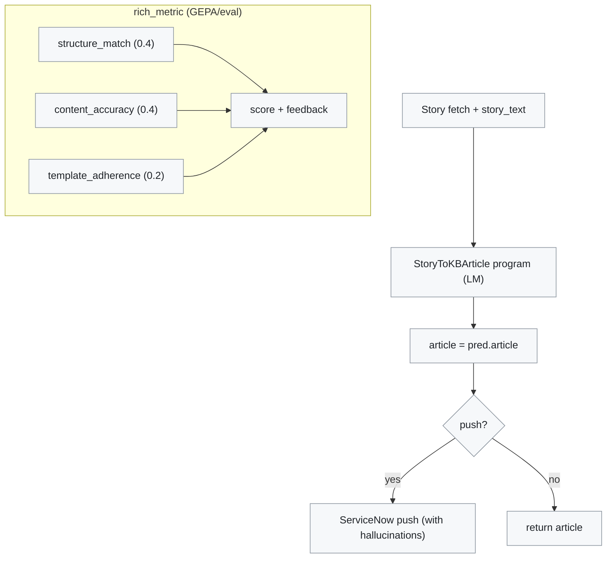
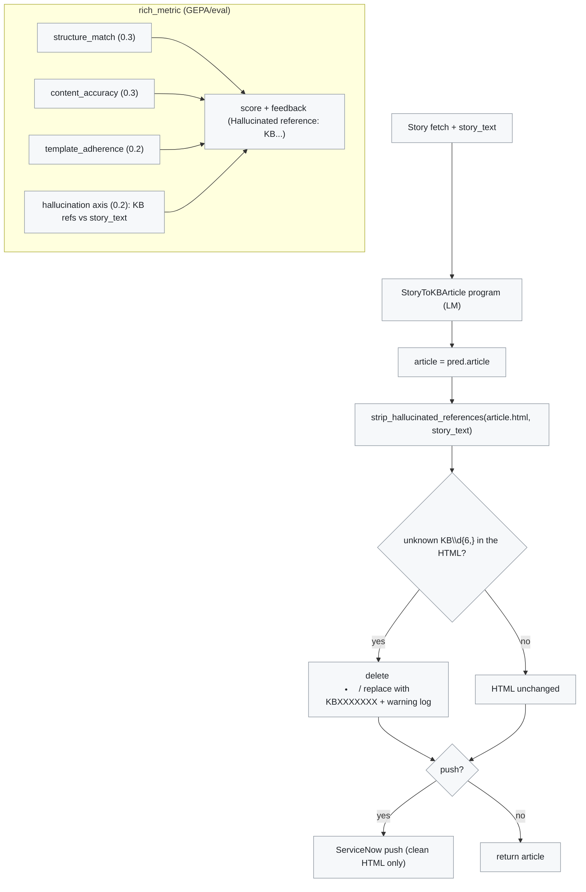
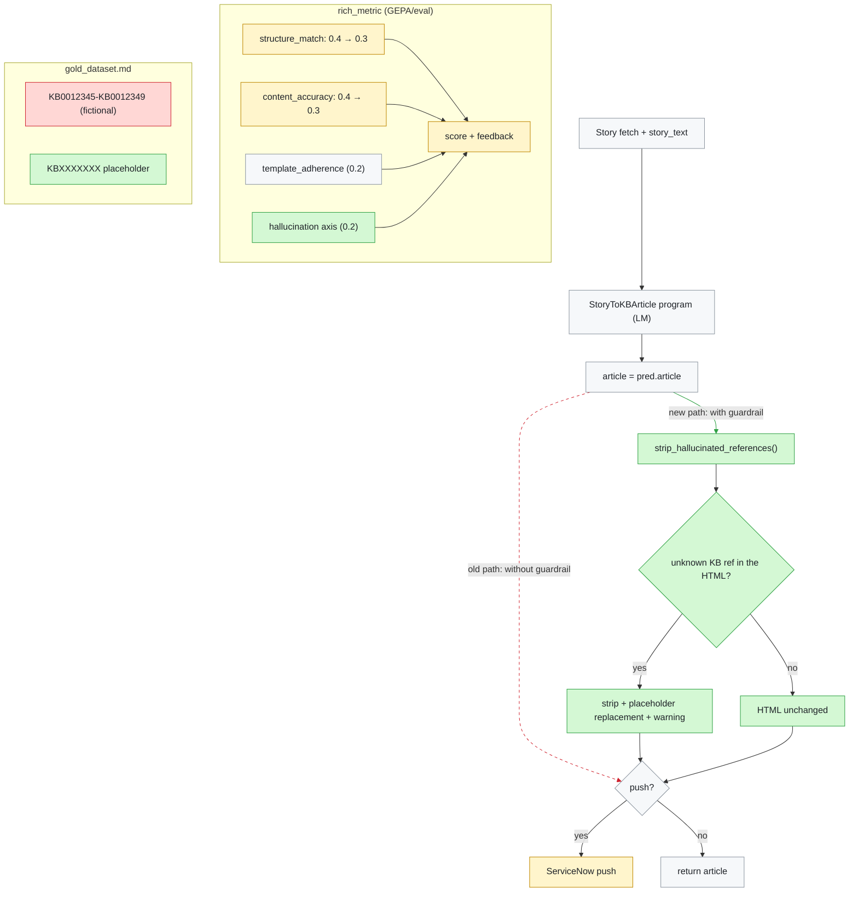

# Spec 004 — Hallucination-Free KB Generation: what changed?

**Scope:** `bacdce8..HEAD` (spec 004 commits) · **Lens:** control-flow
**Behaviour-carrying files:** `eval/metric.py`, `src/snow_kb/pipeline.py` (+ `data/examples/gold_dataset.md` data cleanup, tests)

The change builds two lines of defence against hallucinated KB references (e.g. fictional `KB0012345`):
(1) the new **hallucination axis** of the `rich_metric` penalises unknown KB article numbers during GEPA optimisation,
(2) the **`strip_hallucinated_references()` guardrail** built into the pipeline removes every KB reference that does not appear in the source Story text *before* the push. In addition, the fictional article numbers of the gold dataset were replaced with a `KBXXXXXXX` placeholder.

## Before (old behaviour)

## After (new behaviour)

## What changed (merged diff view)

Green is new, red is removed, yellow is modified; grey is untouched. The dashed red edges are the old, no longer existing paths.

**Edge numbering (merged view):** 0: S→G, 1: G→A, 2: A⇢P (deleted), 3: A→GU (new), 4: GU→GUQ, 5: GUQ→STRIP, 6: GUQ→CLEAN, 7: STRIP→P, 8: CLEAN→P, 9: P→SN, 10: P→R.

## Notes

- **Modified, not new:** the `ServiceNow push` node is the same code path, but it now only receives HTML that passed the guardrail — hence yellow. The composition of the metric's `score + feedback` got a new feedback branch ("Hallucinated reference(s): ...").
- **Weight change:** the metric axes go 0.4/0.4/0.2 → 0.3/0.3/0.2 (+0.2 hallucination) — this is an intentional trade-off: non-hallucinated output gets 0.2 by default (see the threshold adjustment of `test_mismatch_returns_low_score`).
- **Left out of the diagram:** the `eval/gepa_optimize.py` CLI (`python -m eval.gepa_optimize`), the tests (8 new ones), and the server startup load — these fell into the main change in spec 003; here only the hallucination-specific behaviour is shown.
- **Result:** baseline 0.386 → optimized 0.962 (GEPA re-run on clean data), valset 0/2 hallucinations, the production article verified via the ServiceNow API to be clean.
